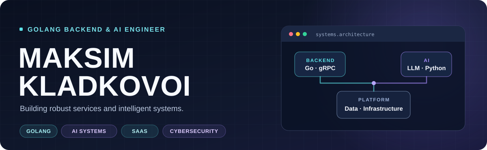

<div align="center">



<br/>

[](https://git.io/typing-svg)

**Привет! Я Максим 👋**  
Пишу backend-сервисы, автоматизирую процессы и собираю проекты, которыми удобно пользоваться.  
Люблю понятную архитектуру, надёжные API, наблюдаемость и инженерный подход.

[](https://t.me/maksonchigg)
[](https://github.com/mmmakskl)
[](https://github.com/mmmakskl)

</div>

---

### `> about_me`

```go
package main

type Developer struct {
    Name     string
    Focus    []string
    Approach string
}

var me = Developer{
    Name:     "Maksim Kladkovoi",
    Focus:    []string{"Backend", "APIs", "Automation", "Databases"},
    Approach: "Build things that are useful, maintainable and observable.",
}
```

- 🛠️ **Делаю:** API и сервисы, Telegram-ботов и Mini Apps, интеграции и автоматизацию.
- 🧩 **Интересно:** Go, проектирование backend-систем, PostgreSQL, gRPC, observability и системное программирование.
- 🔍 **В работе:** тестирование, воспроизводимые окружения, техническая документация и качество кода.
- 💬 **Связаться:** [Telegram @maksonchigg](https://t.me/maksonchigg).

### `> tech_stack`

<div align="center">

**Languages & frameworks**


**Databases, infrastructure & tooling**


</div>

### `> selected_projects`

<table>
<tr>
<td width="50%" valign="top">

#### 💱 [test-finance](https://github.com/mmmakskl/test-finance)
**Go · gRPC · PostgreSQL**

Сервис получения и расчёта курсов USDT с gRPC API, хранением истории и стратегиями расчёта. Есть Docker-окружение, метрики Prometheus и трассировка через OpenTelemetry / Jaeger.

[**Explore repository →**](https://github.com/mmmakskl/test-finance)

</td>
<td width="50%" valign="top">

#### ✅ [TaskFlow](https://github.com/mmmakskl/TaskFlow)
**Python · FastAPI · PostgreSQL · Telegram**

Telegram-приложение для совместных задач, шаблонов и подсчёта результатов. Webhook-архитектура, миграции Alembic, тесты и Mini App.

[**Explore repository →**](https://github.com/mmmakskl/TaskFlow)

</td>
</tr>
<tr>
<td width="50%" valign="top">

#### 🛰️ [Dev Job Radar](https://github.com/mmmakskl/dev-job-radar)
**Python · Telegram · Mistral · Next.js**

Мониторинг вакансий из Telegram, AI-классификация, фильтрация под кандидата, персональная лента и интеграция с Google Sheets.

[**Explore repository →**](https://github.com/mmmakskl/dev-job-radar)

</td>
<td width="50%" valign="top">

#### 🌊 [Parallel LBM Simulation](https://github.com/mmmakskl/parallel-lbm-simulation)
**C · Python · Numerical Simulation**

Эксперименты с моделированием потока методом решёточного Больцмана (D2Q9-BGK): тесты, бенчмарки, воспроизводимые результаты и визуализация.

[**Explore repository →**](https://github.com/mmmakskl/parallel-lbm-simulation)

</td>
</tr>
</table>

<details>
<summary><b>📚 More projects</b></summary>
<br/>

- [**riri**](https://github.com/mmmakskl/riri) — Telegram Mini App для управления контентом: React, TypeScript, React Flow и совместная работа.
- [**Knowledge Repository**](https://github.com/mmmakskl/Knowledge_repository) — материалы и заметки по программной инженерии.

</details>

### `> github_activity`

<div align="center">


<br/>


<br/>

[](https://github.com/mmmakskl)

<sub>Statistics are generated by third-party services and may occasionally be unavailable or delayed.</sub>

</div>

---

<div align="center">

**Let's build something useful.**

[](https://t.me/maksonchigg)

<sub>Made with ☕, curiosity and a little bit of engineering.</sub>

</div>
